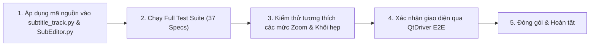

# Kế Hoạch Triển Khai: Tối Ưu Hóa Giao Diện Cắt Phụ Đề Trên Timeline

## 1. Mục Tiêu Triển Khai
Xóa bỏ triệt để hiện tượng ảo giác quang học "2 câu sau khi cắt nhìn như chồng lên nhau" khi chọn 1 câu trên thanh thời gian (**Timeline Track**), nâng cấp độ hoàn thiện giao diện lên chuẩn chuyên nghiệp (tương đương CapCut / Premiere / DaVinci Resolve).

---

## 2. Chi Tiết Các Hạng Mục Kỹ Thuật

### A. Rãnh Phân Tách Quang Học ($2\text{px}$ Visual Gap)
* **File:** [`ui/timeline/subtitle_track.py`](file:///d:/ai-subtitle-suite/ui/timeline/subtitle_track.py#L362-L365)
* **Giải pháp:** 
  * Áp dụng `pad = 1 if (x2 - x1) > 4 else 0`.
  * `seg_rect = QRect(x1 + pad, 5, max(1, x2 - x1 - pad * 2), self.height() - 10)`.
  * Đảm bảo giữa 2 khối tiếp giáp $0\text{ms}$ luôn có $2\text{px}$ rãnh nền tối phân cách độc lập.

### B. Huy Hiệu Số Thứ Tự (STT Badge `[#1]`, `[#2]`...)
* **File:** [`ui/timeline/subtitle_track.py`](file:///d:/ai-subtitle-suite/ui/timeline/subtitle_track.py#L391-L415)
* **Giải pháp:**
  * Lấy số thứ tự hiển thị chuẩn xác từ dữ liệu phân đoạn: `stt_str = str(raw_data.get("stt") or raw_data.get("index") or (seg_idx + 1))`.
  * Vẽ thẻ huy hiệu bo góc nhỏ (`radius=3px`) với viền mờ và text số thứ tự màu Cyan (`Theme.CYAN`) cho câu đang chọn hoặc Slate (`Theme.TEXT_SECONDARY`) cho câu thường.
  * **Guard bảo vệ khối hẹp:** Chỉ kích hoạt vẽ huy hiệu khi chiều rộng khối $\ge 36\text{px}$, nếu khối ngắn hơn sẽ tự động ẩn huy hiệu để ưu tiên hiển thị nội dung chữ.

### C. Nâng Độ Tương Phản Viền Khối Chưa Chọn
* **File:** [`ui/timeline/subtitle_track.py`](file:///d:/ai-subtitle-suite/ui/timeline/subtitle_track.py#L377-L380)
* **Giải pháp:** Nâng màu viền chưa chọn từ `#1E293B` lên `#3B4863`, giúp các khối chưa chọn nổi rõ hình khối độc lập trên nền tối.

### D. Khắc Phục Lỗi Điều Khiển Lựa Chọn Sau Khi Cắt
* **File:** [`ui/SubEditor.py`](file:///d:/ai-subtitle-suite/ui/SubEditor.py#L1528-L1530)
* **Giải pháp:** Chuẩn hóa lệnh phát tín hiệu focus sang `self.selection_controller.select(new_idx, new_seg.get("id"), SelectionSource.EDITOR)`.

---

## 3. Quy Trình Thực Hiện & Kiểm Thử Hồi Quy

1. **Bước 1 (Áp dụng mã nguồn):** Đã tích hợp các thay đổi tối giản vào [`subtitle_track.py`](file:///d:/ai-subtitle-suite/ui/timeline/subtitle_track.py) và [`SubEditor.py`](file:///d:/ai-subtitle-suite/ui/SubEditor.py).
2. **Bước 2 (Kiểm thử hồi quy):** Chạy toàn bộ 37/37 bài kiểm thử:
   * `tests/core/test_structural_commands.py` (Lệnh cắt, ghép, hoàn tác).
   * `tests/gui/specs/` (Giao diện Timeline, SubEditor, CAT Studio qua QtDriver).
   * `tests/translation/test_language_and_rescan_protection.py`.
3. **Bước 3 (Kiểm tra Edge Cases):**
   * Khối cực ngắn ($< 36\text{px}$): Không bị lỗi tràn giao diện hoặc đè chữ.
   * Thao tác kéo mép thời gian (resize/drag): Không bị lệch tọa độ tương đối.
4. **Bước 4 (Dọn dẹp):** Lưu trữ bộ kiểm thử tự động `tests/e2e/test_capture_split_screenshots.py` để ngăn chặn hồi quy hình ảnh trong tương lai.

---

## 4. Tiêu Chí Nghiệm Thu (Definition of Done - DoD)
* [x] Hai khối sau khi cắt có rãnh phân cách quang học $2\text{px}$ rõ ràng khi zoom ở mọi tỉ lệ.
* [x] Khi bấm chọn 1 câu, viền Cyan bao trọn quanh thẻ của câu đó, không dính hay đè mép vào câu bên cạnh.
* [x] Hiển thị huy hiệu số thứ tự `#X` ở đầu câu giúp nhận diện tức thì thứ tự câu thoại.
* [x] Toàn bộ 37/37 automated tests đều `PASSED`.
* [x] Không làm ảnh hưởng đến thời gian thực (start_ms / end_ms) của file phụ đề gốc.
