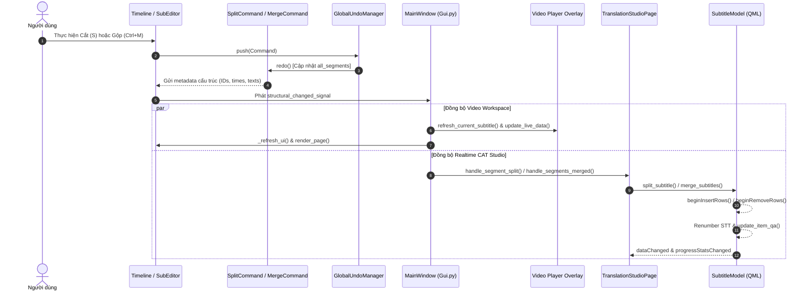

# Kế Hoạch Triển Khai: Đồng Bộ Thời Gian Thực Cắt & Gộp Phụ Đề Giữa Video Workspace và AI CAT Studio

**Mã Đặc Tả:** `DEV-SPEC-REALTIME-STRUCTURAL-SYNC-001`  
**Ngày lập kế hoạch:** 2026-11-04  
**Trạng thái:** Sẵn sàng triển khai (Pending Approval)  
**Tác giả:** Senior QA Lead / Software Quality Architect  

---

## 1. Mục Tiêu Kỹ Thuật (Objective)
Đảm bảo đồng bộ 2 chiều tức thời (**Real-time Invariant Synchronization**) giữa **Video Workspace** (Timeline Track, SubEditor Table, Video Player) và **AI CAT Studio** (QML SubtitleModel) khi thực hiện các thao tác thay đổi cấu trúc phụ đề:
1. **Cắt câu (Split):** Khi 1 câu trên Video Workspace bị cắt làm 2:
   - Nếu câu đó đang tồn tại trong hàng đợi của CAT Studio: mục đó trong CAT Studio lập tức được tách thành 2 dòng phụ đề con độc lập với mốc thời gian chuẩn xác, văn bản gốc chia nửa tương ứng, cấp mã định danh `segment_id` (UUID) mới cho câu sau, đánh lại STT toàn bộ danh sách, trạng thái dịch chuyển về `PENDING` (để AI dịch chuẩn xác từng câu con).
   - Nếu Hoàn tác cắt (`Ctrl+Z`), CAT Studio lập tức hoàn tác, gộp lại dòng phụ đề gốc ban đầu.
2. **Gộp câu (Merge):** Khi 2 câu trên Video Workspace được gộp lại thành 1:
   - Nếu 2 câu đó đang tồn tại trong CAT Studio: 2 mục này lập tức gộp thành 1 dòng duy nhất với mốc thời gian bao trọn, văn bản gốc ghép lại, văn bản dịch ghép lại, dòng thứ 2 được loại bỏ khỏi `SubtitleModel`, đánh lại STT toàn bộ danh sách.
   - Nếu Hoàn tác gộp (`Ctrl+Z`), CAT Studio lập tức hoàn tác, tách trả lại 2 dòng phụ đề ban đầu.
3. **Bảo toàn tính nhất quán Video Workspace & An toàn Ghi đè:**
   - Video Player Overlay và Timeline Waveform Track phản chiếu ngay lập tức dữ liệu mới mà không bị lệch phụ đề.
   - Cơ chế `Overwrite Guard` (`timeline_orig == cat_orig`) luôn giữ trạng thái bảo toàn tuyệt đối, triệt tiêu nguy cơ ghi đè lệch câu hoặc ghi đè bản dịch cụt.

---

## 2. Sơ Đồ Kiến Trúc & Luồng Tín Hiệu (Architecture & Signal Flow)

---

## 3. Chi Tiết Các Hạng Mục Cần Triển Khai (Work Breakdown Structure)

### Hạng Mục 1: Khắc phục khiếm khuyết trong `SplitCommand` & `MergeCommand`
* **File 1.1:** [`core/subtitle_editing/commands/split_command.py`](file:///d:/ai-subtitle-suite/core/subtitle_editing/commands/split_command.py)
  * Bảo đảm cả câu trước và câu mới sinh sau khi cắt đều sở hữu `id` UUID chuẩn xác (nếu câu mẹ chưa có `id` thì tự động sinh để chống mất dấu).
  * Tách cả trường `original_text` bằng cùng thuật toán chia ngắt câu `_split_text_at_midpoint` (nếu có `original_text`).
  * Khởi tạo trạng thái dịch chuẩn mực: Cả 2 câu con đều được reset `translation = ""` và `translation_status = "PENDING"` (để AI dịch chuẩn xác từng câu).
  * Lưu trữ metadata cấu trúc: `original_id`, `new_id`, `split_time_ms`, `split_time_str`, `text1`, `text2`, `orig1`, `orig2`.
* **File 1.2:** [`core/subtitle_editing/commands/merge_command.py`](file:///d:/ai-subtitle-suite/core/subtitle_editing/commands/merge_command.py)
  * Ghép nối đầy đủ trường `translation`: `merged_trans = f"{trans1} {trans2}".strip()`.
  * Cập nhật `translation_status`: Nếu cả 2 đều đã có bản dịch thì là `"EDITED"`, nếu thiếu thì `"PENDING"`.
  * Lưu trữ metadata phục hồi đầy đủ khi Undo: `original_seg1`, `original_seg2`.

### Hạng Mục 2: Bổ sung API Đột Phá Hàng (Atomic Row Mutation) vào `SubtitleModel` (QML Engine)
* **File 2.1:** [`core/translation/models/subtitle.py`](file:///d:/ai-subtitle-suite/core/translation/models/subtitle.py)
  * Thêm phương thức `split_subtitle(row_idx: int, seg1_data: dict, seg2_data: dict)`:
    * Cập nhật `_subtitles[row_idx]` với thông tin câu 1 (`end_time`, `original`, `translation`, `status`).
    * Sử dụng `self.beginInsertRows(QModelIndex(), row_idx + 1, row_idx + 1)`.
    * Chèn `seg2_data` vào vị trí `row_idx + 1`.
    * Kết thúc bằng `self.endInsertRows()`.
    * Cập nhật lại số thứ tự `index` (STT) và `studio_index` từ vị trí `row_idx` tới cuối bảng.
    * Gọi `self.dataChanged` cho `row_idx` và phát `self.progressStatsChanged.emit()`.
  * Thêm phương thức `merge_subtitles(row_idx: int, merged_data: dict)`:
    * Cập nhật `_subtitles[row_idx]` với `merged_data`.
    * Sử dụng `self.beginRemoveRows(QModelIndex(), row_idx + 1, row_idx + 1)`.
    * Loại bỏ phần tử: `self._subtitles.pop(row_idx + 1)`.
    * Kết thúc bằng `self.endRemoveRows()`.
    * Đánh lại STT `index` và `studio_index` từ `row_idx` đến hết.
    * Gọi `self.dataChanged` cho `row_idx` và phát `self.progressStatsChanged.emit()`.
  * Thêm các phương thức hoàn tác `undo_split_subtitle()` và `undo_merge_subtitles()` tương ứng.
  * *Lợi thế kiến trúc:* Tương thích 100% với `FilteredSubtitleModel` nhờ lắng nghe các sự kiện hàng tự nhiên (`rowsInserted`, `rowsRemoved`).

### Hạng Mục 3: Lớp Điều Phối tại `TranslationStudioPage`
* **File 3.1:** [`ui/pages/translation_studio_page.py`](file:///d:/ai-subtitle-suite/ui/pages/translation_studio_page.py)
  * Khai báo các handler nhận sự kiện cấu trúc từ Studio:
    * `handle_segment_split(original_id: str, seg1: dict, seg2: dict)`: Tìm `original_id` trong `subtitle_model`. Nếu thấy, gọi `subtitle_model.split_subtitle()`.
    * `handle_segment_split_undo(original_id: str, new_seg_id: str, original_seg: dict)`: Khôi phục lại trạng thái trước khi cắt.
    * `handle_segments_merged(id1: str, id2: str, merged_seg: dict)`: Tìm `id1` và `id2`. Nếu cả 2 đều có trong tab Dịch, gọi `subtitle_model.merge_subtitles()`.
    * `handle_segments_merge_undo(id1: str, seg1: dict, seg2: dict)`: Khôi phục lại 2 dòng phụ đề.
  * Guard an toàn cho luồng LLM (`TranslationController Guard`):
    * Nếu `translation_controller.is_busy()` trên câu đang bị cắt/gộp: gọi `cancelTranslation()` kịp thời để tránh lỗi xung đột tiến trình nền (race condition).
    * Nếu câu đang active trên workspace dịch bị ảnh hưởng, tải lại dữ liệu mới vào khung gõ dịch: `self.translation_controller.loadSubtitle(matched_idx)`.

### Hạng Mục 4: Tích Hợp Tín Hiệu Đồng Bộ Realtime tại `SubEditor.py` & `Gui.py`
* **File 4.1:** [`ui/SubEditor.py`](file:///d:/ai-subtitle-suite/ui/SubEditor.py)
  * Bổ sung các Qt Signals:
    * `segment_split_applied = Signal(str, dict, dict)` (original_id, seg1, seg2)
    * `segment_split_undone = Signal(str, str, dict)` (original_id, new_id, original_seg)
    * `segments_merge_applied = Signal(str, str, dict)` (id1, id2, merged_seg)
    * `segments_merge_undone = Signal(str, dict, dict)` (id1, seg1, seg2)
  * Kích hoạt phát tín hiệu khi `SplitCommand` và `MergeCommand` được thực thi hoặc hoàn tác.
* **File 4.2:** [`ui/Gui.py`](file:///d:/ai-subtitle-suite/ui/Gui.py)
  * Nối các signals trên từ `sub_editor` sang các handler tương ứng của `page_translation`.
  * Đảm bảo video player và timeline render lại mượt mà không độ trễ.

---

## 4. Kế Hoạch Kiểm Thử Tự Động & Hồi Quy (Verification & Test Suite)

Tạo bộ test chuyên biệt: `tests/translation/test_cat_studio_realtime_structural_sync.py`
Bao gồm 6 ca kiểm thử nghiệm thu (Test Cases):
1. **TC-SPLIT-001 (Realtime Split Sync):** Nạp phụ đề vào tab Dịch $\rightarrow$ Cắt câu trên Studio $\rightarrow$ Kiểm tra `SubtitleModel` tăng thêm 1 row, row 1 nhận nửa đầu, row 2 nhận nửa sau, cả 2 mang status `PENDING`, STT tự động tịnh tiến chính xác.
2. **TC-SPLIT-UNDO-001 (Undo Split Sync):** Nhấn Undo $\rightarrow$ `SubtitleModel` tự động xóa row 2 và phục hồi row 1 về nguyên trạng.
3. **TC-MERGE-001 (Realtime Merge Sync):** Nạp 2 câu vào tab Dịch $\rightarrow$ Gộp 2 câu trên Studio $\rightarrow$ Kiểm tra `SubtitleModel` giảm 1 row, câu gộp có text/original nối nhau và translation ghép nối, status `EDITED`.
4. **TC-MERGE-UNDO-001 (Undo Merge Sync):** Nhấn Undo $\rightarrow$ `SubtitleModel` tái lập 2 câu riêng biệt với đầy đủ bản dịch của từng câu.
5. **TC-OVERWRITE-GUARD-COMPAT (Export Compatibility):** Sau khi cắt/gộp, chuyển qua lại giữa các tab hoặc bấm Xuất sang Studio $\rightarrow$ Overwrite Guard cho phép đồng bộ mượt mà vì `timeline_orig == cat_orig` hoàn toàn khớp nhau.
6. **TC-ISOLATION-GUARD (Non-CAT Subtitles):** Cắt/gộp một câu KHÔNG nằm trong danh sách dịch $\rightarrow$ CAT Studio không bị ảnh hưởng, không phát sinh lỗi exception.

Chạy song song toàn bộ 5 suites hồi quy hiện có (hơn 100 tests) để đảm bảo không gãy tính năng nào.

---

## 5. Tiêu Chí Hoàn Thành (Definition of Done - DoD)
- [ ] Khi cắt 1 câu trên Timeline mà câu đó đã có bên tab Dịch: tab Dịch tức thì chia câu đó thành 2 câu mới, thời gian và câu gốc đồng bộ chuẩn xác.
- [ ] Khi gộp 2 câu trên Timeline mà 2 câu đó đã có bên tab Dịch: tab Dịch tức thì gộp thành 1 câu duy nhất, ghép cả câu gốc lẫn câu dịch.
- [ ] Phím tắt Hoàn tác (`Ctrl+Z`) và Làm lại (`Ctrl+Y`) đồng bộ tức thì trên cả Video Workspace và CAT Studio.
- [ ] Không xung đột luồng khi AI đang dịch nền (LLM worker cancel an toàn nếu câu bị can thiệp).
- [ ] 100% test cases mới và các test suite hồi quy vượt qua (`PASSED`).
