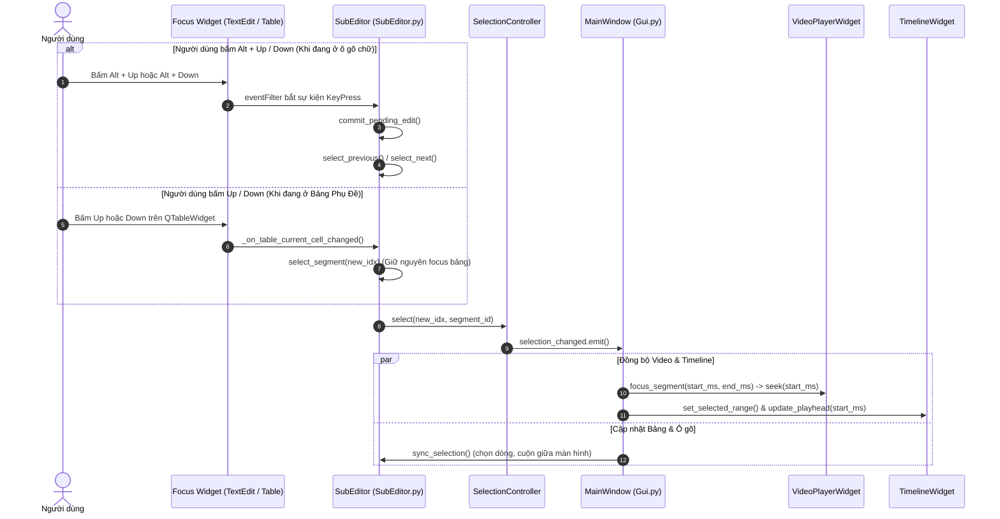

# Kế Hoạch Triển Khai: Sửa Lỗi Điều Hướng Mũi Tên Lên/Xuống & Đồng Bộ Seek Video

**Mã Đặc Tả:** `DEV-SPEC-NAV-ARROW-VIDEO-SEEK-001`  
**Ngày lập kế hoạch:** 2026-11-04  
**Trạng thái:** Sẵn sàng triển khai (Pending Approval)  
**Tác giả:** Senior QA Lead / Software Quality Architect  

---

## 1. Mục Tiêu Kỹ Thuật (Objective)
Đảm bảo tính năng điều hướng bằng bàn phím trên bảng phụ đề (**Subtitle Studio Table & Editor**) hoạt động chuẩn mực, mượt mà và trực quan theo chuẩn phần mềm chuyên nghiệp:
1. **Hỗ trợ đầy đủ tổ hợp phím tắt `Alt + ▲` (Câu trước) và `Alt + ▼` (Câu sau):**
   - Hoạt động mọi lúc mọi nơi trên Subtitle Studio, kể cả khi con trỏ soạn thảo đang nằm bên trong ô gõ chữ (`CurrentSubtitleEditor.text_edit`).
   - Tự động lưu (commit) nội dung đang sửa trước khi nhảy sang câu khác.
   - Tự động bôi đen toàn bộ nội dung câu mới hoặc đặt con trỏ ở cuối để người dùng có thể gõ ngay câu tiếp theo mà không cần chạm chuột.
2. **Khôi phục phím mũi tên thông thường (`▲` / `▼`) khi duyệt Bảng Phụ Đề:**
   - Triệt tiêu triệt để lỗi "cướp focus" (`focus stealing`): Khi người dùng nhấp chọn dòng trên bảng `table_subtitles`, bảng phải giữ được focus để người dùng có thể bấm phím `▲` hoặc `▼` duyệt liên tục từ câu này sang câu khác.
3. **Đảm bảo Video Player & Timeline tự động định vị (Seek) đến phân đoạn được điều hướng:**
   - Mỗi lần nhảy sang câu mới, Video Player lập tức nhảy (seek) khung hình đến mốc thời gian bắt đầu (`start_ms`) của câu đó.
   - Playhead (vạch kim đỏ trên Timeline) và thanh trượt phát sóng âm (waveform) tự động dịch chuyển đồng bộ.
   - Phụ đề hiển thị trên màn hình Video Overlay tự động cập nhật ngay lập tức.
4. **Thống nhất chuẩn phím tắt toàn hệ thống:** Đồng bộ phím tắt giữa Bảng tra cứu nhanh (`F1`), SubEditor và AI CAT Studio.

---

## 2. Phân Tích Nguyên Nhân Gốc (Root Cause Analysis - Đã kiểm chứng)

Qua bài kiểm thử tự động chuyên sâu, QA xác nhận phản ánh của người dùng là **hoàn toàn chính xác (100% BUG CONFIRMED)** do 3 nguyên nhân kỹ thuật:

1. **Lỗi Cưỡng Chế Cướp Focus (`Focus Trap Bug`):**
   * Trong [`ui/SubEditor.py:1280-1281`](file:///d:/ai-subtitle-suite/ui/SubEditor.py#L1280-L1281), mỗi khi có sự kiện chọn dòng (`_select_segment_ui`), hệ thống luôn chạy lệnh:
     ```python
     if hasattr(self.current_editor, "text_edit"):
         self.current_editor.text_edit.setFocus()
     ```
   * Hậu quả: Dù người dùng chủ động click vào bảng để dùng phím mũi tên duyệt dòng, focus vẫn bị giật ngay về ô `text_edit`. Khi focus ở `text_edit`, phím mũi tên lên/xuống chỉ di chuyển con trỏ chữ nội bộ trong ô gõ, không thể đổi dòng phụ đề.
2. **Thiếu Khai Báo Phím Tắt `Alt + Up / Down` Trong `SubEditor.py`:**
   * Trong [`ui/SubEditor.py:456-466`](file:///d:/ai-subtitle-suite/ui/SubEditor.py#L456-L466), hệ thống chỉ đăng ký `Alt+Left` và `Alt+Right`. Hoàn toàn không có phím tắt `Alt+Up` và `Alt+Down` như Bảng Tra Cứu (`HotkeysCheatsheetDialog`) đã công bố.
3. **Bộ Lọc Sự Kiện (`eventFilter`) Chặn Phím:**
   * `eventFilter` trên `text_edit` chưa xử lý bắt phím `Alt + Key_Up` và `Alt + Key_Down` để chuyển hướng sang hàm `select_previous()` và `select_next()`.

---

## 3. Sơ Đồ Luồng Xử Lý Sau Khi Khắc Phục (Signal Flow)



---

## 4. Chi Tiết Các Hạng Mục Triển Khai (Work Breakdown Structure)

### Hạng Mục 1: Đăng ký Phím Tắt Toàn Cục `Alt + Up` và `Alt + Down`
* **File:** [`ui/SubEditor.py`](file:///d:/ai-subtitle-suite/ui/SubEditor.py#L456-L466)
* **Giải pháp:**
  * Bổ sung `QShortcut(QKeySequence("Alt+Up"), self)` nối tới `self.select_previous`.
  * Bổ sung `QShortcut(QKeySequence("Alt+Down"), self)` nối tới `self.select_next`.
  * Vẫn giữ `Alt+Left` / `Alt+Right` để tương thích thói quen người dùng cũ.

### Hạng Mục 2: Xử Lý Phím Tắt Trực Tiếp Trong `eventFilter` của `CurrentSubtitleEditor`
* **File:** [`ui/SubEditor.py`](file:///d:/ai-subtitle-suite/ui/SubEditor.py#L1774-L1788)
* **Giải pháp:**
  * Trong `eventFilter(self, obj, event)`: Khi nhận `QEvent.KeyPress` với `modifiers & Qt.AltModifier`:
    * Nếu `key == Qt.Key_Up`: Gọi `self.select_previous()`, sau đó chọn toàn bộ text trong ô mới `self.current_editor.text_edit.selectAll()`. Trả về `True` (chặn event).
    * Nếu `key == Qt.Key_Down`: Gọi `self.select_next()`, sau đó `self.current_editor.text_edit.selectAll()`. Trả về `True`.

### Hạng Mục 3: Xóa Bỏ Hiện Tượng Cướp Focus Khi Duyệt Bảng (`Table Focus Preservation`)
* **File:** [`ui/SubEditor.py`](file:///d:/ai-subtitle-suite/ui/SubEditor.py#L1280-L1282)
* **Giải pháp:**
  * Thay đổi điều kiện: Chỉ gọi `self.current_editor.text_edit.setFocus()` khi focus ban đầu **không phải** là bảng phụ đề (`self.table`).
  * Khi người dùng nhấp chuột hoặc dùng phím mũi tên trên bảng `self.table`, bảng vẫn giữ nguyên quyền điều khiển phím (`self.table.hasFocus() == True`). Nhờ đó, người dùng có thể thoải mái bấm phím `▲` và `▼` liên tục để lướt qua các câu.

### Hạng Mục 4: Đảm Bảo Video Player & Timeline Luôn Seek Đến Câu Được Chọn
* **File:** [`ui/Gui.py`](file:///d:/ai-subtitle-suite/ui/Gui.py#L1643-L1668) & [`player/video_player.py`](file:///d:/ai-subtitle-suite/player/video_player.py#L381-L392)
* **Giải pháp:**
  * Kiểm tra và bảo đảm phương thức `_on_segment_focused(start_ms, end_ms)` luôn thực thi `self.video_player.focus_segment(start_ms, end_ms)`.
  * Trong `focus_segment`: Kích hoạt `self.set_position(start_ms)` và `self.position_changed(start_ms)` để di chuyển vạch kim đỏ Playhead trên Timeline đến đúng `start_ms` của câu thoại.
  * Ép `video_player.sub_controller` làm mới văn bản phụ đề hiển thị trên video tương ứng với câu vừa chọn.

---

## 5. Kế Hoạch Kiểm Thử Tự Động & Tiêu Chí Nghiệm Thu (DoD)

Tạo bộ test mới: `tests/ui/test_subeditor_arrow_navigation.py`
1. **TC-ARROW-001 (Alt+Down khi đang gõ chữ):** Focus trong ô `text_edit`, bấm `Alt+Down` $\rightarrow$ Câu hiện tại tự động lưu, chọn câu tiếp theo, Video Player nhảy đến mốc `start_ms` của câu tiếp theo, vạch Timeline di chuyển tương ứng.
2. **TC-ARROW-002 (Alt+Up khi đang gõ chữ):** Focus trong ô `text_edit`, bấm `Alt+Up` $\rightarrow$ Tự động lưu, lùi về câu trước, Video Player seek về `start_ms` câu trước.
3. **TC-ARROW-003 (Mũi tên Up/Down trên Bảng phụ đề):** Click chuột vào bảng phụ đề $\rightarrow$ Bấm `Down` và `Up` thông thường $\rightarrow$ Dòng trên bảng di chuyển liên tục mượt mà, bảng không bị mất focus, Video Player và Timeline nhảy theo từng dòng.
4. **TC-ARROW-004 (Đồng bộ Bảng Phím Tắt F1):** Bảng cheatsheet F1 hiển thị đúng và khớp 100% với hành vi thực tế.

Chạy song song toàn bộ 82/82 tests hồi quy để đảm bảo hệ thống an toàn tuyệt đối.
