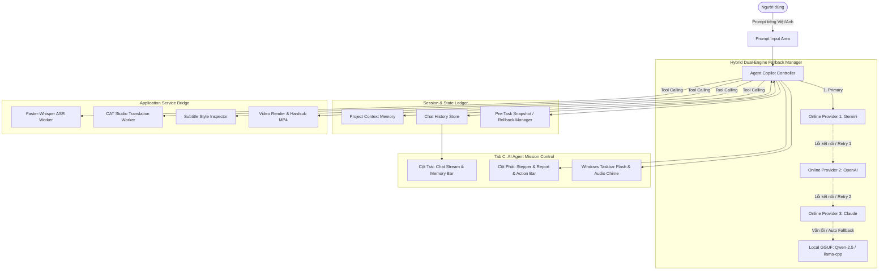

# THIẾT KẾ KỸ THUẬT: HỆ THỐNG AI AGENT COPILOT ĐIỀU KHIỂN ỨNG DỤNG BẰNG NGÔN NGỮ TỰ NHIÊN
**Dự án:** AI Subtitle Suite (`D:\ai-subtitle-suite`)  
**Ngày lập:** 08/11/2026  
**Trạng thái:** FINAL DESIGN – CHỜ PHÊ DUYỆT CỦA NGƯỜI DÙNG (READY FOR APPROVAL)  

---

## 1. MỤC TIÊU & BỐI CẢNH (INTENT & WHY)
AI Subtitle Suite là bộ phần mềm xử lý phụ đề video chuyên nghiệp với nhiều module mạnh mẽ: Nhận diện giọng nói (Faster-Whisper ASR), CAT Translation Studio (Local LLM GGUF), Waveform/Timeline Editor và Hardsub Video Render. Hiện tại, người dùng phải tự click chuột chuyển qua lại giữa nhiều tab, tự điều chỉnh thông số và kích hoạt từng công đoạn thủ công.

Mục tiêu của tính năng này là xây dựng một **AI Agent Copilot (Trợ lý Điều hành Thông minh)** tích hợp trực tiếp trong ứng dụng. Người dùng chỉ cần gõ một câu lệnh tự nhiên (ví dụ: *"Nhận diện giọng nói video này, dịch sang tiếng Việt giữ nguyên thuật ngữ kỹ thuật, chỉnh font Arial vàng viền đen rồi render video hardsub"*), Agent sẽ tự phân tích, lập kế hoạch chi tiết, phối hợp các module dịch vụ trong ứng dụng và tương tác kiểm duyệt từng bước với người dùng.

---

## 2. MỤC TIÊU CỐT LÕI (GOALS), PHẠM VI NGOÀI (NON-GOALS) & ĐIỀU CẤM (ANTI-GOALS)

### A. Goals
1. **Toàn quyền điều khiển nghiệp vụ (All-in-one Orchestration):** Agent có khả năng kích hoạt và cấu hình toàn bộ các luồng nghiệp vụ cốt lõi thông qua Tool Calling trực tiếp vào Core Services:
   - Nạp và phân tích video/audio.
   - Nhận diện giọng nói ASR (Faster-Whisper model, ngôn ngữ, VAD).
   - CAT Translation Studio (Dịch AI, Glossary, Entity Dictionary).
   - Tinh chỉnh Subtitle Style (Font name, size, màu sắc, viền, vị trí, bóng đổ).
   - Thao tác Timeline/Editor (tách/gộp câu, sửa thời gian, snap viền overlap).
   - Render và xuất file (Hardsub MP4, Subtitle SRT).
2. **Quy trình Kiểm soát Con người Từng bước (Strict Human-in-the-Loop - HITL):**
   - **Giai đoạn 1 (Lập Kế hoạch):** Agent nhận prompt $\rightarrow$ phân tách thành danh sách các bước (Checklist Stepper) $\rightarrow$ người dùng duyệt kế hoạch thì Agent mới chạy bước 1.
   - **Giai đoạn 2 (Thực thi Từng Bước):** Agent chỉ chạy 1 task tại một thời điểm.
   - **Giai đoạn 3 (Báo cáo & Tạm dừng):** Khi task hoàn thành, Agent dừng lại và trình bày bảng báo cáo kết quả chi tiết.
   - **Giai đoạn 4 (Kiểm tra & Sửa đổi):** Người dùng có quyền đọc, nhấp chuột sửa trực tiếp dữ liệu trên bảng báo cáo hoặc chat yêu cầu Agent sửa lại.
   - **Giai đoạn 5 (Cổng Phê duyệt Bước tiếp):** Chỉ khi người dùng bấm *"✔ Đồng ý & Chạy bước tiếp"*, Agent mới bắt đầu task kế tiếp.
3. **Lịch sử Hội thoại & Bộ Nhớ Dự Án Dài Hạn (Context Memory Ledger):**
   - Lưu trữ toàn bộ lịch sử trao đổi (Chat Stream) để người dùng có thể chat chỉ đạo bổ sung.
   - Duy trì một "Sổ cái Ngữ cảnh Dự án" (Project Context Memory) hiển thị trạng thái cố định (Video, Ngôn ngữ nguồn/đích, các quy tắc thuật ngữ, thông số style đã chốt) để AI không bị "quên" (context drift) sau nhiều lượt tương tác.
4. **Cơ chế Dự phòng Đa Nhà Cung Cấp Thông minh (Multi-Provider Hybrid Fallback):**
   - Hỗ trợ đa dạng các nhà cung cấp Online (Google Gemini, OpenAI, Anthropic Claude, OpenRouter, DeepSeek API) thông qua việc lưu nhiều API Key trong Settings.
   - Hỗ trợ mô hình Offline (Local GGUF qua llama-cpp có sẵn trong máy: Qwen-2.5, Gemma-2).
   - Khi người dùng gửi lệnh: Ưu tiên Online Model chính $\rightarrow$ nếu lỗi kết nối/timeout, tự động đổi sang model online dự phòng khác (tối đa 2 lần thử, có thể đổi sang provider khác) $\rightarrow$ nếu vẫn mất kết nối thì tự động chuyển mượt mà về mô hình Local Offline GGUF.
   - Mọi lần chuyển đổi đều thông báo minh bạch trong khung chat (*"Mất kết nối với Gemini, đã chuyển sang OpenAI..."* hoặc *"Đã chuyển về Local Qwen-2.5"*).
5. **Thông báo Khi Hoàn Tất Tác Vụ Dài:**
   - Khi các tác vụ nền kéo dài (như ASR hoặc Render Hardsub) hoàn tất và chuyển sang trạng thái chờ duyệt, ứng dụng phát chuông âm thanh nhẹ (audio chime) và kích hoạt hiệu ứng nhấp nháy biểu tượng trên thanh Taskbar của Windows.
6. **Giao diện Tab Chuyên Dụng (Tab C - Bố cục 1: 2 Cột Song Song):**
   - Thêm tab "Phòng Điều Hành AI Agent" vào thanh điều hướng bên trái.
   - **Cột trái:** Thanh Bộ nhớ Dự án (Project Memory Bar) + Dòng Lịch sử Chat (Chat Stream) + Ô nhập Prompt.
   - **Cột phải:** Thanh tiến trình các bước (Stepper) + Khung Báo cáo Kết quả (Interactive Preview/Editable) + Cặp nút hành động (*"Yêu cầu làm lại task"* / *"✔ Duyệt & Chạy bước tiếp"*).

### B. Non-Goals
1. Không tự động chạy xuyên suốt từ đầu đến cuối mà bỏ qua sự phê duyệt của người dùng (Zero unconfirmed auto-execution).
2. Không thay thế các tab làm việc truyền thống (người dùng vẫn có thể chuyển sang Studio Workspace hoặc CAT Studio để chỉnh sửa thủ công bất kỳ lúc nào; dữ liệu luôn đồng bộ hai chiều).

### C. Anti-Goals
1. **Nghiêm cấm mô phỏng thao tác chuột bề mặt (No GUI coordinate clicking):** Agent không được dùng script click tọa độ ảo trên màn hình. Agent phải điều khiển ứng dụng thông qua kiến trúc **Tool Calling / Service API Bridge** trực tiếp vào các Controller và Service nội bộ đã có.
2. **Không để mất dữ liệu khi mất mạng hoặc khi làm lại task:** Rớt mạng tuyệt đối không được làm crash ứng dụng; cơ chế rollback và fallback sang Local GGUF phải diễn ra an toàn 100%.

---

## 3. RÀNG BUỘC KỸ THUẬT (CONSTRAINTS)
- **Nền tảng:** Python 3.11+, PySide6 (Qt 6.6+), Qt Quick / QML (Obsidian Liquid Dark Theme).
- **Hệ điều hành:** Windows 10/11 (hỗ trợ Windows Taskbar flashing qua `QApplication.alert(win)` và âm thanh qua `QSoundEffect` / `QAudioOutput`).
- **Tương thích kiến trúc hiện tại:**
  - Tích hợp với `WorkspaceService` & `ProjectState` (lưu trữ phiên làm việc, lịch sử chat và memory ledger).
  - Tích hợp với `WaveformService` & `SubtitleGenerationPanel` (ASR trigger & progress listener).
  - Tích hợp với `TranslationController` (CAT Studio LLM translation bridge).
  - Tích hợp với `SubtitleStyleInspector` (Font, size, color, outline styles).
  - Tích hợp với `ExportCenterPage` / `VideoRenderService` (Hardsub MP4 render).

---

## 4. QUYẾT ĐỊNH CỦA NGƯỜI DÙNG (AS DECIDED BY USER)
1. **Phạm vi quyền hạn:** Toàn bộ ứng dụng (gen sub, dịch, hardsub, chỉnh hiệu ứng, timeline).
2. **Cơ chế duyệt:** Lên danh sách kế hoạch $\rightarrow$ người dùng duyệt mới thực thi $\rightarrow$ xong mỗi task báo cáo trước $\rightarrow$ người dùng kiểm tra & sửa chữa $\rightarrow$ người dùng duyệt mới chạy bước tiếp theo.
3. **Hình thái giao diện:** Tab chuyên dụng riêng (Option C) trên thanh điều hướng.
4. **Bố cục nội bộ:** Bố cục 1 (2 cột song song: Cột trái gồm Lịch sử Chat + Bộ nhớ dự án + Prompt; Cột phải gồm Stepper tiến trình + Báo cáo kết quả trực quan + Nút duyệt bước tiếp).
5. **Bộ nhớ & Lịch sử:** Phải có toàn bộ lịch sử chat và bộ nhớ ngữ cảnh dài hạn để AI không bị quên dẫn đến làm sai lệch.
6. **Mô hình AI & Fallback:** Hỗ trợ cả Online lẫn Offline. Hỗ trợ nhập nhiều API Key từ nhiều hãng/provider khác nhau (OpenAI, Gemini, Claude, OpenRouter). Khi người dùng đưa ra câu hỏi/lệnh: Ưu tiên Online $\rightarrow$ lỗi thì đổi model online tối đa 2 lần $\rightarrow$ nếu vẫn mất kết nối thì tự động fallback sang Offline GGUF.
7. **Thông báo:** Có chuông âm thanh nhẹ và nhấp nháy thanh Taskbar Windows khi task hoàn tất và chuyển sang trạng thái chờ duyệt.

---

## 5. CÁC QUYẾT ĐỊNH KỸ THUẬT ĐƯỢC CHỐT (BUILDER'S ARCHITECTURAL CALLS)
Để trả lời các vấn đề cốt lõi mà Reviewer độc lập đưa ra mà không làm thay đổi mục tiêu của người dùng:

1. **Ranh giới Đột biến Trạng thái & Phục hồi (State Mutation & Snapshot Rollback):**
   - **Quyết định:** Áp dụng mô hình **Live State Mutation với Pre-Task Checkpoint Snapshot**.
   - **Cơ chế:** Khi một task chạy, kết quả được ghi trực tiếp vào `ProjectState` và các model hiển thị (để người dùng có thể chuyển sang Studio Workspace hoặc CAT Studio xem video/timeline ngay mà không bị dữ liệu cũ). Tuy nhiên, **ngay trước khi chạy task**, Agent sẽ tự động tạo một snapshot trạng thái (Draft Snapshot). Nếu người dùng bấm *"Yêu cầu làm lại task"*, hệ thống lập tức khôi phục trạng thái về đúng checkpoint trước task đó, loại bỏ triệt để nguy cơ làm bẩn dữ liệu.
2. **Quy tắc Xử lý Chỉnh sửa (Revision Semantics):**
   - **Quyết định:** Mặc định là **Tinh chỉnh tại chỗ (In-place Refinement)** (ví dụ: đổi giọng văn câu dịch, đổi màu chữ). Nếu phản hồi của người dùng làm thay đổi bản chất dữ liệu đầu vào của các bước sau (ví dụ: đổi từ dịch tiếng Việt sang dịch tiếng Hàn), Planner sẽ tự động tính toán lại các bước phụ thuộc phía sau (Downstream Re-synthesis) và hiển thị lại Stepper cập nhật để người dùng duyệt lại kế hoạch.
3. **Phạm vi của Khung Báo cáo Kết quả (`EditableResultReportWidget`):**
   - **Quyết định:** Thiết kế theo dạng **Smart Summary & Quick-Edit Sheet**. 
   - **Cơ chế:** Không nhúng toàn bộ Video Player hay Timeline khổng lồ vào đây (tránh phình to giao diện và xung đột tài nguyên). Thay vào đó, widget hiển thị tóm tắt các chỉ số cốt lõi (số câu, thời lượng, cảnh báo lỗi), danh sách các phân đoạn quan trọng cho phép click sửa text nhanh, cùng một nút tiện ích *"Mở trong Studio Workspace / CAT Studio để chỉnh sửa chuyên sâu"* nếu người dùng muốn can thiệp chi tiết hơn.
4. **Tương tác trên Kế hoạch Stepper (Phase 1):**
   - **Quyết định:** Stepper ở dạng **Hiển thị trực quan kèm nút bật/tắt (skip) bước**. Các điều chỉnh phức tạp (thay đổi tham số, thêm yêu cầu) được thực hiện hoàn toàn tự nhiên qua khung chat với Agent trước khi bấm duyệt.
5. **Cấu trúc Multi-Provider Client:**
   - **Quyết định:** Xây dựng module `MultiProviderLLMClient` hỗ trợ chuẩn REST tương thích OpenAI API (hỗ trợ OpenAI, Google Gemini qua OpenAI-compatible endpoint, Anthropic qua adapter, OpenRouter, DeepSeek). Giao diện Settings sẽ có mục quản lý danh sách API Key với thứ tự ưu tiên (Primary $\rightarrow$ Fallback 1 $\rightarrow$ Fallback 2).

---

## 6. KIẾN TRÚC THÀNH PHẦN (COMPONENT ARCHITECTURE)

---

## 7. KẾ HOẠCH BÀN GIAO & BƯỚC TIẾP THEO
Sau khi người dùng xem xét và phê duyệt văn bản thiết kế này:
1. Chuyển sang bước lập kế hoạch chi tiết (`writing-plans`).
2. Chia nhỏ thành các task triển khai độc lập, có kiểm thử tự động xác minh (TDD) cho từng module:
   - Module 1: `MultiProviderLLMClient` & Hybrid Fallback Engine.
   - Module 2: `AgentContextLedger`, `SnapshotManager` & Tool Registry.
   - Module 3: `AgentCopilotController` (HITL State Machine: Plan $\rightarrow$ Review $\rightarrow$ Execute $\rightarrow$ Report $\rightarrow$ Advance).
   - Module 4: Giao diện QML/PySide6 Tab C (`AIAgentMissionControlView`).
   - Module 5: Windows Notification (Taskbar alert + Audio chime).
   - Module 6: End-to-End GUI Tests xác minh toàn bộ luồng tự động hóa.
